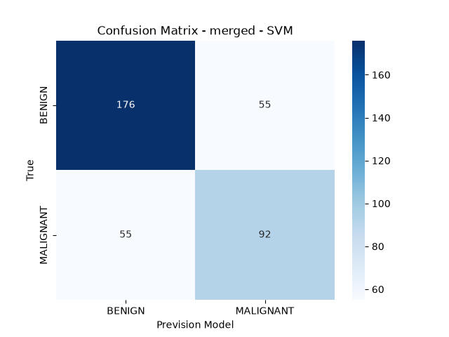

<p align="center">
  <h1 align="center">Mammography Classifier</h1>
</p>

<p align="center">
  <i>A Python machine learning pipeline that classifies mammographic masses as benign or malignant, comparing radiomics, a pretrained ResNet-50, and their fusion.</i>
</p>

<p align="center">
  
  
  
  
  
</p>

On the official test split (378 images), the SVM trained on the fused features reached **70.9% accuracy**. Radiomics alone stayed around **59%**.

The written report is in Brazilian Portuguese: [`docs/artigo.pdf`](docs/artigo.pdf).

## 1. Pipeline

```text
CBIS-DDSM (masses, official split)
        │
        ▼
OpenCV: bilateral filter + CLAHE
        │
        ├──────────────────────────────┐
        ▼                              ▼
PyRadiomics                      ResNet-50 (PyTorch)
93 features                      2048 features
inside the lesion mask           on the cropped ROI
        │                              │
        └──────────┬───────────────────┘
                   ▼
        three representations
        radiomics · ResNet-50 · fusion
                   │
                   ▼
        StandardScaler + SVM (RBF) and Random Forest
                   │
                   ▼
        test: accuracy, F1, sensitivity,
        specificity, and confusion matrix
```

1. CBIS-DDSM is downloaded with `kagglehub`, and the official mass CSV paths are resolved to the local JPEGs.
2. Every image goes through a bilateral filter and CLAHE (OpenCV).
3. PyRadiomics describes the lesion inside the mask. A pretrained ResNet-50, loaded with PyTorch, describes the cropped ROI. The network is kept frozen: the classification head is removed and the 2048-dimensional embedding is the feature vector.
4. SVM and Random Forest (scikit-learn) are trained on each representation and on the fusion, using the training split only.
5. All six models are evaluated on the test split.

`BENIGN` and `BENIGN_WITHOUT_CALLBACK` are class 0. `MALIGNANT` is class 1, the positive class for sensitivity and F1.

## 2. What each model receives

| Representation | Source | Features used by the classifier |
| --- | --- | ---: |
| Radiomics | PyRadiomics on the full mammogram plus the mask | 93 |
| ResNet-50 | Cropped ROI, pretrained extractor | 2048 |
| Fusion | Both vectors joined by lesion id | 2141 |

The 93 radiomic features are the default PyRadiomics families: first-order (18), GLCM (24), GLRLM (16), GLSZM (16), GLDM (14), and NGTDM (5). The extractor uses `binWidth` 25, normalization, B-spline interpolation, and `force2D`.

ResNet-50 is the ImageNet-pretrained network exposed by PyTorch (`torchvision.models.resnet50`, `ResNet50_Weights.DEFAULT`). The same architecture is published on the Hugging Face Hub as [`microsoft/resnet-50`](https://huggingface.co/microsoft/resnet-50). This repository loads the model with PyTorch and uses it only as a feature extractor: `fc` becomes `nn.Identity()`. The ROI is converted to RGB, resized to 240×240, and normalized with the ImageNet mean and standard deviation. The article describes this resize as 224×224; the value the code runs is in `src/extract_resnet50.py`.

Both classifiers use `random_state=42`:

- SVM with an RBF kernel, `C=2.0`, and `gamma='scale'`
- Random Forest with 100 trees

Features go through a `StandardScaler` fit on the training split. The test split is only transformed.

## 3. Data

Source: [CBIS-DDSM on Kaggle](https://www.kaggle.com/datasets/awsaf49/cbis-ddsm-breast-cancer-image-dataset) (`awsaf49/cbis-ddsm-breast-cancer-image-dataset`).

The pipeline uses the official **mass** split (`mass_case_description_train_set.csv` and `mass_case_description_test_set.csv`). Calcifications are left out.

| Split | Images | Benign (class 0) | Malignant (class 1) |
| --- | ---: | ---: | ---: |
| Train | 1318 | 681 | 637 |
| Test | 378 | 231 | 147 |

Training benign cases are 577 `BENIGN` and 104 `BENIGN_WITHOUT_CALLBACK`. The test split has 194 and 37.

## 4. Test results

Metrics for the final pipeline (bilateral filter + CLAHE). Sensitivity is the recall of the malignant class. Specificity is the recall of the benign class.

| Features | Model | Accuracy | F1 | Sensitivity | Specificity |
| --- | --- | ---: | ---: | ---: | ---: |
| Fusion | SVM | **0.7090** | **0.6259** | 0.6259 | 0.7619 |
| ResNet-50 | SVM | 0.7037 | 0.6242 | 0.6327 | 0.7489 |
| Fusion | Random Forest | 0.6852 | 0.5966 | 0.5986 | 0.7403 |
| ResNet-50 | Random Forest | 0.6852 | 0.5795 | 0.5578 | 0.7662 |
| Radiomics | SVM | 0.5952 | 0.4632 | 0.4490 | 0.6883 |
| Radiomics | Random Forest | 0.5873 | 0.4834 | 0.4966 | 0.6450 |

Fusion improves ResNet-50 alone by a small margin: SVM accuracy goes from 0.7037 to 0.7090 and specificity from 0.7489 to 0.7619, with a small drop in sensitivity (0.6327 to 0.6259). Radiomics alone stays near 0.59.

### 4.1. Example: fused SVM report

File [`results/report_merged_SVM.txt`](results/report_merged_SVM.txt). The saved report keeps its original Portuguese labels.

```text
Results of testing: merged with model: SVM
Acurácia:       0.7090
F1-Score:       0.6259
Sensibilidade:  0.6259
Especificidade: 0.7619

              precision    recall  f1-score   support

      BENIGN       0.76      0.76      0.76       231
   MALIGNANT       0.63      0.63      0.63       147

    accuracy                           0.71       378
```

The matching matrix is [`results/confusion_matrix_merged_SVM.png`](results/confusion_matrix_merged_SVM.png).



Reading that matrix on the test split:

|  | Predicted benign | Predicted malignant |
| --- | ---: | ---: |
| Benign | 176 | 55 |
| Malignant | 55 | 92 |

176 + 92 correct predictions out of 378 give an accuracy of 0.7090. The 92 malignant cases found out of 147 give a sensitivity of 0.6259. The 176 benign cases found out of 231 give a specificity of 0.7619.

The six reports and six matrices from the final run are in [`results/`](results/).

## 5. Preprocessing comparison

The preprocessing kept for the final result is a bilateral filter (`d=9`, `sigmaColor=75`, `sigmaSpace=75`) followed by CLAHE (`clipLimit=2.0`, 8×8 grid), in [`src/preprocessing.py`](src/preprocessing.py).

The other variants are in [`results/ablation/`](results/ablation/). The table below is the fused-SVM accuracy, which was the criterion for the main result:

| Preprocessing | Folder | Fused SVM accuracy |
| --- | --- | ---: |
| Bilateral + CLAHE (final) | `results/` | **0.7090** |
| Histogram equalization | `results/ablation/histogram_equalization/` | 0.6852 |
| No preprocessing | `results/ablation/no_preprocessing/` | 0.6825 |
| CLAHE | `results/ablation/clahe/` | 0.6799 |
| Median | `results/ablation/median/` | 0.6772 |
| Unsharp | `results/ablation/unsharp/` | 0.6667 |
| Bilateral | `results/ablation/bilateral/` | 0.6640 |

Inside the ablation folders, the ResNet-50 metrics are repeated (SVM accuracy 0.6958). The final run, in `results/`, extracted ResNet-50 again with bilateral + CLAHE and reached 0.7037.

## 6. Article

[`docs/artigo.pdf`](docs/artigo.pdf) is written in Brazilian Portuguese. The title is *Classificação de Imagens de Tecido de Mama* (*Classification of Breast Tissue Images*), by Aurélio Gabriel Ortiz Vieira and Gustavo Benitez Frehse (UFPR).

The text describes this pipeline: CBIS-DDSM preparation, PyRadiomics features, ResNet-50 as an extractor, SVM, Random Forest, and the comparison of the six models on the test split. The figures discussed there (fused SVM accuracy 0.7090 and F1 0.6259) are the ones in `results/`.

## 7. How to run

The environment needs Python 3, a Kaggle API credential (`~/.kaggle/kaggle.json`), and disk space for CBIS-DDSM. The first run downloads the dataset and extracts the features. PyRadiomics over the full set is the slow step. If the feature CSVs already exist in `results/`, extraction is skipped.

```bash
bash scripts/setup.sh
source .venv/bin/activate
python src/main.py
```

`scripts/main.sh` runs the same `python src/main.py` from the repository root. Running it again rewrites the reports and matrices in `results/`. With the current CSVs and `random_state=42`, the metrics in the main table come out the same.

Outputs of the final run:

```text
results/radiomics_features_{train,test}.csv
results/resnet_features_{train,test}.csv
results/merged_features_{train,test}.csv
results/report_{radiomics,resnet50,merged}_{SVM,random_forest}.txt
results/confusion_matrix_{radiomics,resnet50,merged}_{SVM,random_forest}.png
```

## 8. Layout

```text
src/dataset.py              CBIS-DDSM download and official mass split
src/preprocessing.py        bilateral filter + CLAHE
src/extract_radiomics.py    PyRadiomics
src/extract_resnet50.py     ResNet-50 (PyTorch) feature extractor
src/main.py                 fusion, training, and metrics for the six models
scripts/setup.sh            virtual environment and dependencies
scripts/main.sh             shortcut for src/main.py
requirements.txt
results/                    metrics and features from the final run
results/ablation/           preprocessing variants
docs/artigo.pdf             written report (Brazilian Portuguese)
```

## 9. Limitations

The test split has 231 benign and 147 malignant cases, and the training split has 1318 images. Specificity stays above sensitivity for all six models: the best one still calls 55 of the 147 malignant lesions benign. The gain of fusion over ResNet-50 alone is small. These numbers compare representations and classifiers on this split. The study is a model-evaluation project, and it is not a diagnostic system.
